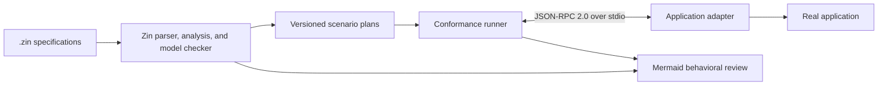

# Repository plugin architecture

**Status:** proposed  
**Audience:** Zin maintainers, adapter authors, and application teams

## Summary

Zin should integrate with any codebase as a **repository-local behavioral sidecar**, not as an in-process library embedded into each host language. The core remains stack-neutral. A small application adapter translates Zin scenarios into real application calls through one versioned, language-neutral protocol.

This proposal adds four capabilities:

1. Repository discovery and machine-readable command output.
2. A JSON-RPC adapter protocol over standard input and output.
3. `zin conform`, which executes model scenarios against an application.
4. SDKs and scaffolding that make adapters small and easy to review.

The specification remains the source of behavioral truth. The adapter must not reimplement business rules.

## Goals

- Work with applications written in any language or framework.
- Keep `zin check` pure: it verifies specifications and never executes repository code.
- Require only a thin adapter for each application.
- Run the same unchanged specification against multiple implementations.
- Report exact action, state, and expectation differences on failure.
- Support local development, CI, generated reviews, and editor integrations.
- Avoid a native plugin ABI and language-specific semantics in `.zin` files.

## Non-goals

- Automatically proving arbitrary application source code correct.
- Inferring production behavior without a reviewed specification.
- Replacing the application's normal test runner.
- Requiring access to private application state.
- Automatically mapping arbitrary HTTP, UI, or database interfaces in the first release.

## Architecture



Zin has two separate verification paths:

- `zin check` exhaustively verifies the finite model.
- `zin conform` executes reviewed journeys against the real implementation.

Conformance is evidence about implementation behavior, not an exhaustive implementation proof. Reports must keep those claims distinct.

## Repository experience

A typical repository looks like:

```text
my-app/
├── .zin/
│   └── config.json
├── specs/
│   └── account.zin
├── src/
│   └── account.py
└── tests/
    └── zin_adapter.py
```

The initial configuration format is JSON because it is language-neutral, deterministic, and straightforward to describe with JSON Schema.

```json
{
  "version": 1,
  "specs": ["specs/**/*.zin"],
  "application": {
    "command": ["python3", "tests/zin_adapter.py"],
    "cwd": ".",
    "timeout_ms": 5000,
    "isolation": "process"
  }
}
```

Commands from the repository root:

```sh
zin init       # Scaffold configuration and an adapter, without inferring behavior
zin check      # Discover and verify models; do not launch the application
zin conform    # Execute scenarios through the configured adapter
zin report     # Include model and implementation conformance results
```

Existing commands with explicit file paths remain valid.

## Adapter protocol

The transport is newline-delimited JSON-RPC 2.0 over stdin/stdout. Standard output is reserved for protocol messages; adapter logs go to standard error. The runner owns process startup, shutdown, timeouts, and cleanup.

### Methods

| Method | Direction | Purpose |
|---|---|---|
| `initialize` | Zin → adapter | Negotiate protocol version and capabilities |
| `reset` | Zin → adapter | Establish a clean application state for a scenario |
| `invoke` | Zin → adapter | Invoke an action with named arguments |
| `snapshot` | Zin → adapter | Read the application's projected public state |
| `shutdown` | Zin → adapter | Stop cleanly and release resources |

`initialize` returns the supported protocol version and optional capabilities. Unknown optional methods must not prevent interoperability.

### Values

Protocol values are tagged so host-language representations cannot change Zin semantics:

```json
{"type": "integer", "value": "9223372036854775807"}
{"type": "enum", "value": "open"}
{"type": "boolean", "value": true}
```

Integers are decimal strings, avoiding JavaScript's numeric precision limit. Enum values are distinct from arbitrary application strings because Zin enums have declared finite domains.

### Invocation outcomes

An action invocation returns one of:

```json
{"outcome": "accepted"}
{"outcome": "disabled"}
```

`disabled` means the application's domain logic rejected the action. Unexpected exceptions, transport errors, and infrastructure failures are adapter errors, not successful negative tests. Applications should expose a distinct domain-rejection error so adapters do not need to duplicate guards.

### State projection

`snapshot` returns only fields declared by the specification. Applications may contain additional private state. Projection must be deterministic and side-effect free.

## Conformance semantics

For each scenario, the runner:

1. Verifies the model before launching application code.
2. Starts a fresh adapter process under the default `process` isolation mode.
3. Performs version negotiation and calls `reset`.
4. Compares the initial snapshot with the model's initial state.
5. Invokes each action with canonical named arguments.
6. Compares the action outcome and resulting snapshot with the model.
7. Evaluates scenario expectations against the application snapshot.
8. Records visited journeys and transitions for coverage reporting.
9. Shuts down the adapter and reaps the process, including on failure or timeout.

A later `reset` isolation mode may reuse a process only when the adapter explicitly supports reliable reset semantics.

### Negative scenarios

Add one scenario construct:

```zin
scenario "An overdraft is refused"
  reject withdraw with amount = 1
  expect balance is 0
```

`reject` has exact semantics in both verification paths:

- The action is disabled in the current model state.
- The state does not change.
- The application returns `disabled`, not an unexpected error.
- The application snapshot also remains unchanged.

This makes important disabled paths reviewable and executable without writing implementation-specific assertions.

## Machine interface

Before adding the transport, Zin should expose stable machine-readable boundaries:

```sh
zin check --format json
zin scenarios --format json
```

Publish JSON Schemas for:

- Repository configuration.
- Scenario plans and tagged values.
- Diagnostics and source locations.
- Adapter requests, responses, and capabilities.
- Conformance results and coverage.

Use separate exit-code classes for successful verification, behavioral failure, specification/configuration errors, and adapter/protocol errors. Preserve human-readable output as the default.

## Security and process behavior

- Running `zin conform` executes repository code and must be an explicit, documented trust decision.
- `zin check`, `zin diagram`, and model-only `zin report` never launch an adapter.
- Commands are argument arrays, not shell-evaluated strings.
- Every adapter invocation has a timeout and a single owner responsible for cleanup.
- Protocol messages have size limits; malformed messages fail closed.
- Adapter stderr is captured separately and attached to diagnostics on failure.
- No adapter process persists as a background service by default.

## Delivery plan

### Phase 1: Machine interface

- Add configuration discovery and specification globbing.
- Add JSON output and stable diagnostics.
- Publish schemas and compatibility tests.
- Add `zin init` for configuration scaffolding.

**Exit criterion:** external tooling can discover and consume scenario plans without parsing human output.

### Phase 2: Conformance runner

- Implement the JSON-RPC transport and process lifecycle.
- Add `reject` to the language and model runner.
- Add initial-state, action-outcome, snapshot, and expectation checks.
- Add field-level diffs and source-aware diagnostics.

**Exit criterion:** a protocol test adapter passes valid journeys and fails incorrect states, actions, and negative scenarios.

### Phase 3: Reference Python SDK

- Convert the existing account integration example to the adapter protocol.
- Hide transport code behind a small Python SDK.
- Test correct and deliberately broken account implementations.
- Document adapter reset, dispatch, projection, and domain rejection.

**Exit criterion:** users implement only application mapping, not JSON-RPC or process management.

### Phase 4: Prove stack neutrality

- Implement the same account adapter in Rust, Node.js, or Go.
- Run the unchanged account specification against both implementations.
- Add cross-adapter golden tests and protocol compatibility tests.
- Provide one additional `zin init --adapter ...` scaffold.

**Exit criterion:** changing the implementation language changes only the adapter and configuration.

### Phase 5: Repository UX

- Add implementation conformance and journey coverage to Markdown reports.
- Add CI examples for GitHub Actions and GitLab CI.
- Add an LSP for parser and semantic diagnostics.
- Keep editor Mermaid previews as thin clients of the report generator.

**Exit criterion:** a team can adopt Zin locally, in review, and in CI without adopting a particular application stack.

## Test strategy

- Golden tests for JSON Schemas, scenario plans, and diagnostics.
- Unit tests for tagged values across the complete signed 64-bit range.
- Fake adapters for malformed messages, crashes, hangs, wrong states, and unexpected errors.
- Process cleanup tests that fail if a child remains alive.
- Differential tests running one specification against two implementation languages.
- Regression tests proving model-only commands never launch configured adapters.
- Compatibility tests for every published protocol version.

## Acceptance criteria

- A Python project can adopt Zin without changing its application architecture.
- A second implementation uses the same unchanged specification.
- A broken implementation reports the exact scenario step and state difference.
- A rejected action cannot be confused with an application crash.
- Hung or crashed adapters never leave orphan processes.
- Model verification and implementation conformance are reported as separate claims.
- No host-language SDK is required by Zin's core parser or model checker.
